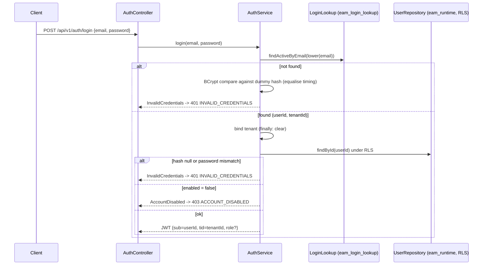

# US-001: User Login and Role-Based Access

**Epic:** EPIC-01 Platform Foundation
**Actor:** All MVP personas (Maria, Dwayne, Jess, Priya, Sam) — administered by Sam Whitfield, System Administrator
**Status:** CODE_REVIEW (implementation complete 2026-10-20, awaiting REVIEWER and LIBRARIAN)
**Scope:** FULL_STACK

## User Story
As a **platform user**, I want to **log in and be granted access scoped to my role**, so that **I only see the screens and actions relevant to my job, and every action I take is attributable to me**.

## Acceptance Criteria (Gherkin)
```gherkin
Scenario: Successful login routes to role-appropriate home screen
  Given a user account exists with role "Dispatcher"
  When the user logs in with valid credentials
  Then the user lands on the Dispatch board
  And the user sees only the navigation items permitted for the Dispatcher role

Scenario: Invalid credentials are rejected
  Given a user account exists
  When the user submits an incorrect password 
  Then login is denied
  And no session is created

Scenario: A user without a role cannot access role-gated screens
  Given a user is authenticated but has no role assigned
  When the user attempts to open the Dispatch board
  Then access is denied with a clear message
```

## Edge Cases
- Account locked/disabled by an administrator — login denied with a distinct message from "wrong password."
- Session expiry mid-task — user is prompted to re-authenticate without losing unsaved field-form data (see US-019 for offline nuance).

## INVEST Self-Check
- [x] Independent — no other story required for this to be valuable or testable.
- [x] Negotiable — describes login/RBAC outcome, not a specific auth provider.
- [x] Valuable — every other MVP story depends on knowing who is acting.
- [x] Estimable — standard RBAC pattern, well understood.
- [x] Small — fits one PR.
- [x] Testable — Gherkin ACs above are pass/fail unambiguous.

## Field Contract Table
**Scope:** FULL_STACK

| UI Field | API Param | DB Column | Type | Required |
|---|---|---|---|---|
| Username/email | `email` (POST /api/v1/auth/login request) | `users.email` | string, max 320, email format | Yes |
| Password | `password` (POST /api/v1/auth/login request, write-only, never returned) | `users.password_hash` (BCrypt; compared, never selected into a response) | string, 1-128 chars on input; VARCHAR(100) hash at rest | Yes |
| Role badge (post-login) | `user.role` (login response and GET /api/v1/auth/me) | `users.role` | enum string: OPERATOR, DISPATCHER, FIELD_TECHNICIAN, MAINTENANCE_SUPERVISOR, SYSTEM_ADMIN; null = no role | No (null for a user with no role) |
| N/A (session) | `accessToken` (login response) | none, signed JWT, not stored | string (JWT) | Yes on success |
| N/A (session) | `expiresIn` (login response, seconds) | none, from `eam.auth.token-ttl` | integer | Yes on success |
| N/A (error banner) | `code`, `message` (error body) | none | string | Yes on error |
| N/A (backend only: disabled account message) | none | `users.enabled` | boolean, default true | Yes (DB), not exposed |

**ARCH sign-off:** [x] Solution Architect, 2026-10-20 (design below)

**BA sign-off:** [x] Mike Barnes — ACs approved 2026-10-20

## Decision Log
- 2026-10-20 (Mike Barnes): JWT access token only, no refresh tokens in this story.
- 2026-10-20 (Mike Barnes): email is globally unique; tenant is found from the email at login.
- 2026-10-20 (Mike Barnes): users are created by seed/test fixtures only; admin create-user is a later story.
- 2026-10-20 (ARCH): login does not widen `eam_login_lookup` grants. See Architect Design, "Login flow".

## Architect Design (ARCHITECT, 2026-10-20)

**Input Acceptance Gate:** ACCEPT. 3 ACs, measurable, edge cases named, no implementation detail, no contradictions, fits a few days. Platform Reuse Check: no existing auth service or user-facing login capability in the codebase or Story_Map; US-003 (audit) consumes the user id this story binds to `TenantContextHolder`.

### Schema (migration `V20261020_0900__Add_user_credentials_and_role.sql`)

`eam.users` is tenant-owned and already has RLS, `(tenant_id, deleted_at)` index and runtime grants. Add columns only; no new table, so no new policy or grant.

| Column | Type | Null | Notes |
|---|---|---|---|
| `password_hash` | VARCHAR(100) | yes | BCrypt. Null means the account cannot log in. |
| `role` | VARCHAR(30) | yes | CHECK in the five role values. Null means authenticated but no role (AC 3). |
| `enabled` | BOOLEAN | no, default TRUE | FALSE = disabled by an administrator (edge case). |

Plus `CREATE UNIQUE INDEX uq_users_email_active ON eam.users (lower(email)) WHERE deleted_at IS NULL;` so email is globally unique among active users (decision above). The index is enforced by the database regardless of RLS.

`eam_login_lookup` grants stay unchanged (`id, tenant_id, email, deleted_at`). It is used only to resolve `email -> (user id, tenant id)`. Everything else is read through `eam_runtime` after the tenant is bound, under RLS.

### Login flow



- The disabled check runs only after the password verifies, so an attacker cannot learn account status without the password. Wrong password and unknown email return the same 401 body.
- JWT: HS256 via the existing jjwt dependency. Claims `sub` (user id), `tid` (tenant id), `role` (omitted when null), `iat`, `exp`. TTL from `eam.auth.token-ttl`, default `PT1H`. Secret from `EAM_JWT_SECRET` (min 32 bytes; startup fails if shorter).
- `JwtAuthenticationFilter` (before `UsernamePasswordAuthenticationFilter`): parse and verify the Bearer token, set the `SecurityContext` with authority `ROLE_<role>` when a role is present, bind tenant and user via `TenantContextHolder`, and `clear()` in `finally`. Invalid or expired token: no authentication set, entry point returns 401.
- `SecurityConfig`: `permitAll` on `/actuator/health` and `POST /api/v1/auth/login`; everything else authenticated. Remove `httpBasic`. Add `@EnableMethodSecurity` so later stories gate with `@PreAuthorize`. 403 handler returns the `ACCESS_DENIED` body.
- Role gating mechanism only. No Dispatch board API exists yet (US-014). AC 3 is proven with a probe controller in test sources annotated `@PreAuthorize("hasRole('DISPATCHER')")`.

### API contract

| Endpoint | Auth | Request | Success | Errors |
|---|---|---|---|---|
| `POST /api/v1/auth/login` | none | `{email, password}` both `@NotBlank`, email `@Email` | 200 `{accessToken, tokenType:"Bearer", expiresIn, user:{id, email, role}}` | 400 validation, 401 `INVALID_CREDENTIALS`, 403 `ACCOUNT_DISABLED` |
| `GET /api/v1/auth/me` | Bearer | none | 200 `{id, email, role}` | 401 |

Error body record: `ApiError(String code, String message)`. Messages: `INVALID_CREDENTIALS` "Invalid email or password."; `ACCOUNT_DISABLED` "This account is disabled. Contact your administrator."; `ACCESS_DENIED` "You do not have access to this screen." Password and token never appear in logs.

### Domain model

- `User` entity (`com.eam.auth`): id UUID, tenantId UUID, email, passwordHash, role (`Role` enum, nullable), enabled, createdAt, updatedAt, deletedAt. Mapped read-mostly; no write endpoints in this story.
- `Role` enum: `OPERATOR, DISPATCHER, FIELD_TECHNICIAN, MAINTENANCE_SUPERVISOR, SYSTEM_ADMIN` (from Personas.md).
- `LoginLookupRepository` (JDBC, own `DataSource` bean `loginLookupDataSource` as `eam_login_lookup`, not the primary). This closes the "Not yet wired" note in ARCHITECTURE.md.
- Validation: request DTO records with `@Valid` at the controller (trust boundary); no re-validation inside the service.

### Multi-tenancy and soft delete

`users` queries run under RLS with the tenant bound, plus the application-side filter `deleted_at IS NULL`. The lookup query also filters `deleted_at IS NULL`. No cross-tenant joins. Writes: none in this story.

### Flyway plan

One migration: `V20261020_0900__Add_user_credentials_and_role.sql`, header comment explains why lookup grants are unchanged. `MigrationIT` extended to assert the columns, CHECK and unique index.

### Config wiring (CODER must verify, per CODER.md)

New property `EAM_JWT_SECRET` -> `eam.auth.jwt-secret` in `application.yml`; pass through `docker-compose.dev.yml`, `docker-compose.test.yml`, `.env.example` and the CI workflow env. Hit the real `/api/v1/auth/login` in the test stack and paste the response in the story.

### Frontend (data display requirements only; layout belongs to HFD)

- Screens: Login; role home placeholder per role; "access denied" state; session-expired return to Login.
- Role to home route: OPERATOR `/alarms`, DISPATCHER `/dispatch`, FIELD_TECHNICIAN `/work`, MAINTENANCE_SUPERVISOR `/closure`, SYSTEM_ADMIN `/admin`. Each is a placeholder titled with the screen name until its own story ships.
- Navigation shows only items for screens that exist for the user role. A user with no role sees no navigation and an access denied message.
- Token kept in `sessionStorage`; a 401 from any API call clears it and routes to Login with the session-expired message.

### Known gaps carried as debt (not blocking)

- A disabled or deleted user keeps a valid token until it expires (TTL 1h). Revocation arrives with refresh tokens.
- No login rate limiting or lockout. Needs its own story.

## Files in Scope

backend/pom.xml
backend/src/main/resources/application.yml
backend/src/main/resources/db/migration/V20261020_0900__Add_user_credentials_and_role.sql
backend/src/main/java/com/eam/auth/**
backend/src/main/java/com/eam/config/SecurityConfig.java
backend/src/main/java/com/eam/config/LoginLookupDataSourceConfig.java
backend/src/test/java/com/eam/auth/**
backend/src/test/java/com/eam/support/**
backend/src/test/java/com/eam/db/MigrationIT.java
backend/src/test/resources/**
frontend/package.json
frontend/package-lock.json
frontend/src/**
docker-compose.dev.yml
docker-compose.test.yml
.env.example
.github/workflows/**
ARCHITECTURE.md
docs/design/US-001/**
docs/project/stories/US-001-user-login-rbac.md
docs/project/Story_Map.md
docs/project/Sprint_Log.md
docs/project/gate_log.csv
docs/standards/style-guide.md


## Coder Evidence (2026-10-20)

**Migration added:** `V20261020_0900__Add_user_credentials_and_role.sql`.

**Backend** (`./mvnw.cmd verify`): checkstyle 0 violations, PMD clean, JaCoCo gate passed. 34 unit tests and 29 integration tests, 0 failures (`JwtServiceTest`, `AuthServiceTest`, `AuthControllerTest`, `AuthIT`, `MigrationIT`, `RlsCanaryIT`, `HealthEndpointIT`, `TenantContextHolderTest`).

**Frontend:** `npm run lint` clean, `npm run build` clean, 41 Vitest tests passing.

**AC to test map**

| AC | Tests |
|---|---|
| Successful login routes to role home | `AuthIT.dispatcherLogsInAndTokenCarriesTheirRole`, `App.test.tsx` "AC 1" group (all five roles) |
| Invalid credentials rejected, no session | `AuthIT.wrongPasswordAndUnknownEmailGetTheSame401AndNoToken`, `App.test.tsx` "AC 2" group |
| No role cannot reach role-gated screens | `AuthIT.dispatcherReachesRoleGatedEndpointAndOtherRolesAndNoRoleAreDenied`, `App.test.tsx` "AC 3" group |
| Edge: disabled account | `AuthIT.disabledAccountGetsDistinctMessageOnlyWithCorrectPassword`, `AuthServiceTest`, App "disabled account" |
| Edge: session expiry | `AuthIT.expiredTokenIsRejected`, `App.test.tsx` "expired stored token" |

**External config wiring (EAM_JWT_SECRET):** declared in `application.yml`, `docker-compose.dev.yml` (required), `docker-compose.test.yml` (test-only value), `.env.example`. Tests supply their own via `AbstractPostgresIT`; CI needs no extra env.

**Live smoke on the real test stack** (`docker-compose.test.yml`, port 9191, user seeded with a pgcrypto BCrypt hash):
- `POST /api/v1/auth/login` dispatcher: 200, `expiresIn` 3600, role `DISPATCHER`, token 259 chars.
- `GET /api/v1/auth/me` with that token: 200, same user. Without token: 401. Wrong password: 401 `INVALID_CREDENTIALS`.
- Browser (Vite on 5273 proxied to 9191): login landed on `/dispatch`, nav showed only "Dispatch board", badge "Dispatcher"; reload kept the session; `/alarms` showed Access denied with a home link; Sign out returned to `/login`. 0 console errors after the first page load (1 error on the initial load not investigated, likely favicon).

**Defect found and fixed during build:** exposing a second `JdbcTemplate` bean for the lookup pool made `RlsCanaryIT` see all tenants (the auto-configured runtime template backed off). Removed the bean; recorded in ARCHITECTURE.md.

**Visual check (2026-10-20, real screenshots via headless Edge over CDP, test stack backend):** login and shell viewed at 1280px and 390px in dark and light themes, plus Access denied (with role, and no role). Two defects found and fixed: tagline overlapped the power-line art on desktop; login form clipped and heading collided with the logo at 390px (grid min-content overflow). Mobile user card widened to full row. After fixes: 0 horizontal overflow at both widths, layouts match `style-guide-poc.html`. The first pass of this evidence only used the accessibility tree and missed both defects.

**Not done / carried:** REVIEWER audit; LIBRARIAN sign-off; Sprint_Log close-out.
