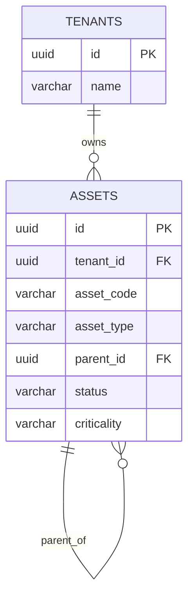

# US-002: Canonical Asset Record and Search

**Epic:** EPIC-01 Platform Foundation
**Actor:** Maria Alvarez, Control-Center Operator
**Status:** READY_FOR_DESIGN (ACs approved by Mike Barnes, 2026-10-20)
**Scope:** FULL_STACK

## User Story
As a **control-center operator**, I want to **search for a transformer asset and view its canonical record**, so that **I can confirm which physical asset an event or alarm refers to before I act on it**.

## Acceptance Criteria (Gherkin)
```gherkin
Scenario: Search by Asset ID returns the correct asset
  Given a transformer asset "TX-4587" exists in the platform
  When the operator searches "TX-4587"
  Then the Asset 360 view opens for that asset
  And the header shows Asset ID, status, criticality and location

Scenario: Asset hierarchy is visible
  Given the asset "TX-4587" is on feeder "F-12" under substation "SUB-3"
  When the operator opens the Asset 360 view
  Then the utility → substation → feeder → asset hierarchy is displayed

Scenario: Searching a non-existent Asset ID
  When the operator searches an Asset ID that does not exist
  Then the platform shows "no matching asset" rather than a blank/error screen
```

## Edge Cases
- Duplicate candidate assets from bulk import — out of scope for this story; see US-006 (identity mapping/reconciliation).
- Asset with missing/never-verified location — see US-008.

## INVEST Self-Check
- [x] Independent
- [x] Negotiable
- [x] Valuable — foundational to every downstream workflow screen (alarm, incident, work order all link back to this record).
- [x] Estimable
- [x] Small
- [x] Testable

## Field Contract Table
**Scope:** FULL_STACK

| UI Field | API Param | DB Column | Type | Required |
|---|---|---|---|---|
| Search box (Asset ID) | `assetId` (query on `GET /api/v1/assets`) | `assets.asset_code` | string, trimmed, 1-50 chars, matched exactly and case-insensitively | Yes |
| Asset ID | `assetCode` | `assets.asset_code` | string, max 50, unique per tenant among active rows | Yes |
| Name | `name` | `assets.name` | string, max 255 | Yes |
| Asset type | `assetType` | `assets.asset_type` | enum string: SUBSTATION, FEEDER, TRANSFORMER | Yes |
| Status | `status` | `assets.status` | enum string: IN_SERVICE, OUT_OF_SERVICE, RETIRED | Yes |
| Criticality | `criticality` | `assets.criticality` | enum string: LOW, MEDIUM, HIGH, CRITICAL | Yes |
| Location | `location` = `{latitude, longitude}` (WGS84), null when never recorded | `assets.location` (`geography(Point,4326)`, read with `ST_Y` / `ST_X`) | latitude -90..90, longitude -180..180 | No |
| Manufacturer | `manufacturer` | `assets.manufacturer` | string, max 120 | No |
| Model | `model` | `assets.model` | string, max 120 | No |
| Serial number | `serialNumber` | `assets.serial_number` | string, max 120 | No |
| Hierarchy path (utility→substation→feeder→asset) | `hierarchy[]`, root first, each `{id, assetCode, name, assetType}`; utility entry is `{id: tenant id, name: tenant name, assetType: "UTILITY"}` | `assets.parent_id` chain, `tenants.name` for the utility | array, 1-4 entries | Yes |
| N/A (route) | `{id}` on `GET /api/v1/assets/{id}` | `assets.id` | UUID | Yes |
| N/A (empty state) | `GET /api/v1/assets` returns `200 []` | none | array | Yes |
| N/A (backend only: soft delete, audit) | none | `assets.deleted_at`, `created_at`, `updated_at` | TIMESTAMPTZ | deleted_at: No |

**ARCH sign-off:** [x] Solution Architect, 2026-11-03 (design below)

**BA sign-off:** [x] Mike Barnes — ACs approved 2026-10-20

## Decision Log
- 2026-10-20 (Mike Barnes): assets are one self-referencing table (`asset_type` + `parent_id`) covering substation, feeder and transformer; the tenant is the utility, so there is no utility row.
- 2026-11-03 (ARCH, Tier B): the Asset ID shown to users is a business key `asset_code`, unique per tenant among active rows. The row key stays a UUID.
- 2026-11-03 (ARCH, Tier B): status is IN_SERVICE / OUT_OF_SERVICE / RETIRED; criticality is LOW / MEDIUM / HIGH / CRITICAL. Values follow BRD section 8.1 (lifecycle status, criticality). Both are CHECK-constrained and cheap to extend by migration.
- 2026-11-03 (Mike Barnes, correction): location is a geographic point, not free text. Stored as PostGIS `geography(Point,4326)`; this story enables the extension. US-007 (map pin) and US-008 (freshness) read the same column and add no second location field.
- 2026-11-03 (Mike Barnes): no debt is carried. The parent-type rule is enforced in the migration, and the design lists no deferred gaps.
- 2026-11-03 (ARCH, Tier B): no create, import or edit endpoint. Assets are loaded by seed and test fixtures, like users in US-001. Ingest arrives with US-004 to US-006.
- 2026-11-03 (ARCH, Tier B): any authenticated user with a role may search and view. A user with no role gets 403 ACCESS_DENIED. Per-role field restrictions are not in the ACs.

## Architect Design (ARCHITECT, 2026-11-03)

**Input Acceptance Gate:** ACCEPT. 3 ACs, measurable, edge cases named, no implementation detail, no contradictions, fits a few days. Platform Reuse Check: no asset code exists in the backend or frontend. No other story delivers search or the Asset 360 view. US-006 (identity mapping) will reference `assets.id`. US-007 and US-008 add location columns. US-009 to US-013 and US-021 link to `assets.id` and reuse `GET /api/v1/assets/{id}`. Do not create a second asset lookup in those stories.

### Schema (migration `V20261103_0900__Create_assets.sql`)

New tenant-owned table `eam.assets`.

| Column | Type | Null | Notes |
|---|---|---|---|
| `id` | UUID | no | PK |
| `tenant_id` | UUID | no | FK `eam.tenants(id)` |
| `asset_code` | VARCHAR(50) | no | Business Asset ID, for example `TX-4587` |
| `name` | VARCHAR(255) | no | |
| `asset_type` | VARCHAR(20) | no | CHECK in SUBSTATION, FEEDER, TRANSFORMER |
| `parent_id` | UUID | yes | Self reference, see below |
| `status` | VARCHAR(20) | no | CHECK in IN_SERVICE, OUT_OF_SERVICE, RETIRED; default IN_SERVICE |
| `criticality` | VARCHAR(20) | no | CHECK in LOW, MEDIUM, HIGH, CRITICAL; default MEDIUM |
| `location` | geography(Point, 4326) | yes | WGS84 point. Null = never recorded. US-008 adds verification on top of this column |
| `manufacturer`, `model`, `serial_number` | VARCHAR(120) | yes | |
| `created_at`, `updated_at` | TIMESTAMPTZ | no | default CURRENT_TIMESTAMP |
| `deleted_at` | TIMESTAMPTZ | yes | soft delete |

Constraints and indexes:
- `UNIQUE (tenant_id, id)` and `FOREIGN KEY (tenant_id, parent_id) REFERENCES eam.assets (tenant_id, id)`. A parent can never belong to another tenant. The FK references a unique key, per the Core Rules.
- `CHECK ((asset_type = 'SUBSTATION') = (parent_id IS NULL))`. Substations are roots; feeders and transformers must have a parent.
- Parent type is enforced by the database: a `BEFORE INSERT OR UPDATE OF asset_type, parent_id` trigger on `eam.assets` rejects a FEEDER whose parent is not a SUBSTATION, and a TRANSFORMER whose parent is not a FEEDER. The trigger function is not `SECURITY DEFINER`, so it reads the parent under the caller's RLS. Every write path, including future imports, gets the rule.
- `CREATE INDEX idx_assets_location ON eam.assets USING GIST (location)` for the map and coordinate search that follow.
- `CREATE UNIQUE INDEX uq_assets_code_active ON eam.assets (tenant_id, lower(asset_code)) WHERE deleted_at IS NULL`. This also serves the search.
- `CREATE INDEX idx_assets_tenant_deleted ON eam.assets (tenant_id, deleted_at)` and `CREATE INDEX idx_assets_parent ON eam.assets (tenant_id, parent_id)`.
- RLS enabled. Policy `assets_tenant_isolation FOR ALL TO eam_runtime` with `USING` and `WITH CHECK` on `tenant_id = NULLIF(current_setting('app.current_tenant', true), '')::uuid`, as for `users`.
- `GRANT SELECT, INSERT, UPDATE ON eam.assets TO eam_runtime`. No DELETE. No grant to `eam_login_lookup`.



Normal form: 3NF. The hierarchy is one adjacency list, so the path is derived, never stored.

### API contract

| Endpoint | Auth | Request | Success | Errors |
|---|---|---|---|---|
| `GET /api/v1/assets?assetId=TX-4587` | Bearer, any role | `assetId` required, trimmed, 1-50 chars | 200 array of 0 or 1 asset summaries `{id, assetCode, name, assetType, status, criticality}` | 400 `VALIDATION_ERROR` when blank, 401, 403 `ACCESS_DENIED` (no role) |
| `GET /api/v1/assets/{id}` | Bearer, any role | UUID path | 200 `{id, assetCode, name, assetType, status, criticality, location, manufacturer, model, serialNumber, hierarchy[]}` | 401, 403, 404 `ASSET_NOT_FOUND` |

- Search is exact and case-insensitive on `asset_code`, so it returns at most one row today. It returns an array so partial or multi-field search (address, feeder, substation per BRD 8.2) can be added later without a breaking change.
- No match returns `200 []`, not 404. The UI renders "no matching asset" (AC 3).
- An ID from another tenant, or a soft-deleted ID, returns 404. RLS plus the application filter make the two cases indistinguishable.
- `hierarchy` is built by a recursive CTE up `parent_id`, filtered by tenant and `deleted_at IS NULL` at every step, plus one synthesized utility entry from `tenants.name`. Depth is capped at 10 as a cycle guard.
- Error body reuses `ApiError(code, message)` from US-001. New messages: `ASSET_NOT_FOUND` "No matching asset."; `VALIDATION_ERROR` "Enter an Asset ID."
- Gating: `@PreAuthorize("hasAnyRole('OPERATOR','DISPATCHER','FIELD_TECHNICIAN','MAINTENANCE_SUPERVISOR','SYSTEM_ADMIN')")`. `SecurityConfig` needs no change: `/api/v1/**` is already authenticated.

### Domain model

- `Asset` record (`com.eam.asset`): fields as the table, `location` as `GeoPoint(latitude, longitude)`, plus `AssetType`, `AssetStatus`, `Criticality` enums. Read-only; no write endpoints.
- `AssetRepository`: `findByCodeIgnoreCase(tenantId, code)`, `findById(tenantId, id)`, `findAncestors(tenantId, id)`. Plain SQL on the runtime `JdbcTemplate`, with `ST_Y(location::geometry)` and `ST_X(location::geometry)` in the select list, so no `hibernate-spatial` dependency and no `pom.xml` change. Every query carries the tenant filter and `deleted_at IS NULL`, as defense in depth over RLS.
- `AssetService.search(assetId)` and `AssetService.get(id)`. This is the single lookup that later stories reuse.
- `AssetController` with DTO records. Validation at the controller only.
- Reads run inside a `@Transactional(readOnly = true)` boundary so `SET LOCAL app.current_tenant` applies.

### Multi-tenancy and soft delete

Tenant is taken from `TenantContextHolder`, never from a request parameter. Search and fetch both run under RLS with the application-side tenant filter. No cross-tenant joins. The utility entry reads `tenants` under its own RLS policy. No DELETE anywhere.

### Flyway plan

One migration, `V20261103_0900__Create_assets.sql`. It starts with `CREATE EXTENSION IF NOT EXISTS postgis WITH SCHEMA public;` (Flyway runs as the admin user; dev, test and Testcontainers all use the PostGIS image). A header comment states that `eam_login_lookup` gets no grant. `eam_runtime` must resolve `ST_X`, `ST_Y` and the `geography` type through `public`; CODER proves it with an integration test run as `eam_runtime`. The repository is SQL-only, so there is no entity mapping to ship. `MigrationIT` is extended to assert the extension, the table, the CHECKs, the same-tenant parent FK, the parent-type trigger, the partial unique index, the GIST index, RLS, and that `eam_runtime` has no DELETE. `ARCHITECTURE.md` drops "extension not yet enabled".

### Test plan (for CODER, not code)

- Integration: tenant A cannot see tenant B's asset by search or by id; a soft-deleted asset is invisible; mixed-case and padded search input matches; no match returns `[]`; hierarchy order is utility, substation, feeder, asset; a role-less user gets 403; a point written as `eam_runtime` comes back as the same latitude and longitude; the trigger rejects a feeder under a transformer and a transformer under a substation; a cross-tenant parent is rejected by the FK.
- Frontend: search then Asset 360 header; hierarchy rendering; "no matching asset" state; blank search is blocked. Every interactive element gets a stable test id. Navigation specs click through the real UI.
- Fixtures: a builder that loads one utility, one substation, one feeder and `TX-4587` under a bound tenant as `eam_runtime`, or as admin for RLS tests.

### Frontend (data display requirements only; layout belongs to HFD)

- Screens: asset search, reachable from a nav item for every role with access; Asset 360 at `/assets/:id` with header (Asset ID, name, status, criticality, location), details (manufacturer, model, serial), and the hierarchy path.
- The Asset 360 tabs from the BRD (map, alarms, incidents, work, timeline) are out of scope here. Each arrives with its own story.
- Empty and error states: no match, asset not found (404), loading, session expiry (existing US-001 handling).
- Missing optional values display as "Not recorded", never blank.
- Location displays as latitude and longitude to 5 decimal places (about 1 m). No map in this story; the map pin is US-007.

### Config wiring

No new config property, environment variable or external API key.

### Other stories

Search by address, feeder, substation or coordinates (BRD 8.2) is not in this story's approved ACs and no story covers it yet. That is tracked as CHG-006 (`docs/changes/CHG-006-us-002-multi-field-asset-search.md`), awaiting LIBRARIAN's decision. The Asset 360 panels (map US-007, alarms US-009/US-010, incidents US-011/US-012, work US-013 to US-015, timeline and lineage US-021) are delivered by those stories.

## Files in Scope

backend/src/main/resources/db/migration/V20261103_0900__Create_assets.sql
backend/src/main/java/com/eam/asset/**
backend/src/test/java/com/eam/asset/**
backend/src/test/java/com/eam/support/**
backend/src/test/java/com/eam/db/MigrationIT.java
backend/src/test/resources/**
frontend/src/pages/**
frontend/src/api/**
frontend/src/components/**
frontend/src/styles/**
frontend/src/test/**
frontend/src/App.tsx
frontend/src/App.test.tsx
frontend/src/auth/roles.ts
frontend/src/auth/roles.test.ts
ARCHITECTURE.md
docs/design/US-002/**
docs/project/stories/US-002-canonical-asset-record-search.md
docs/project/Story_Map.md
docs/project/Sprint_Log.md
docs/project/gate_log.csv
